# Canadian Macro Scenarios: Oil Prices and US Growth

Three forward-looking scenarios for the Canadian economy over 2026Q3–2028Q3, built with a VAR that
treats the WTI oil price and US real GDP as external drivers. Each scenario sets a path for those two
drivers; the model translates it into paths for Canadian real GDP, unemployment, CPI inflation, the
Bank of Canada policy rate and new house prices.

**Full write-up:** [report/scenario_report.pdf](report/scenario_report.pdf)



## Scenarios

Driver paths are calibrated to historical episodes in the same data.

| Scenario | WTI (US$/bbl) | US real GDP growth | Historical analog |
| --- | --- | --- | --- |
| Baseline | Eases from $87 to $75 by 2027Q4 | 2.0% | US growth near potential (2010–19 average: 2.4%) |
| Upside | Drifts to $70 by 2028Q3 | 3.0% | 2017–19 expansion (US ~2.8%, WTI $48–70) |
| Downside | Falls to $50 by 2027Q1 (−43%) | 0.5% | 2001 US recession (US 1.1%, WTI −36%) |

## Key results (2027 averages)

| | Canada GDP growth | Unemployment | CPI inflation | Policy rate |
| --- | --- | --- | --- | --- |
| Baseline | 1.4% | 7.1% | 1.3% | 1.8% |
| Upside | 1.8% | 7.0% | 1.3% | 2.0% |
| Downside | 0.2% | 7.6% | 0.4% | 1.4% |

- **Downside:** GDP contracts for three quarters (2026Q4–2027Q2), unemployment peaks near 7.9% in
  2028, and the policy rate is cut to about 0.3% by 2028Q3.

Growth rates are annualized quarter-over-quarter.

## Method

1. **Data** (`R/01_data.R`): seven series from FRED, Statistics Canada and the Bank of Canada, converted
   to quarterly frequency. Growth rates are 400 × Δlog (annualized); oil is 100 × Δlog. The sample is
   2009Q3–2026Q2, set by the start of the Bank of Canada policy-rate series.
2. **Model** (`R/02_scenarios.R`): a VAR(1) in the five Canadian variables, with oil and US GDP growth
   (current and one lag) as exogenous regressors, plus dummies for 2020Q2 and 2020Q3.
3. **Scenarios**: driver paths are set by hand at the top of `R/02_scenarios.R`, and the model produces
   conditional forecasts nine quarters ahead.
4. **Judgment overlay**: the policy rate is floored at 0.25%.

See the [report](report/scenario_report.pdf) for limitations: a linear model, a short sample, and
mean reversion in the forecasts.

## How to run

Requirements: R (4.3 or later) and RStudio.

```bash
git clone https://github.com/Angelgonzales7067/Canada_macro_scenario.git
```

Open `Canada_macro_scenario.Rproj` in RStudio, then in the R console:

```r
renv::restore()          # installs the exact package versions in renv.lock
source("R/run_all.R")    # rebuilds the dataset, model, tables and chart
```

If `renv::restore()` gives trouble, install the packages directly instead:
`install.packages(c("dplyr", "readr", "lubridate", "tidyr", "ggplot2", "vars"))`.

**To change a scenario**, edit the `scenarios` block near the top of `R/02_scenarios.R` and rerun
`source("R/02_scenarios.R")`.

## Repository structure

```
├── R/
│   ├── 01_data.R          # raw CSVs -> data/processed/macro_q.csv
│   ├── 02_scenarios.R     # VAR estimation, scenarios, tables, chart
│   └── run_all.R          # runs both scripts in order
├── data/
│   ├── raw/               # source files, downloaded manually and unedited
│   │   └── SOURCES.md     # source, series ID, selection and download date for each file
│   └── processed/
│       └── macro_q.csv    # model-ready quarterly dataset
├── output/
│   ├── scenario_results.csv   # every quarter x scenario x variable
│   ├── scenario_summary.csv   # 2027 averages and gaps vs. baseline
│   └── scenarios.png          # chart
├── report/
│   ├── scenario_report.tex    # LaTeX source
│   └── scenario_report.pdf    # compiled report
└── renv.lock                  # package versions
```

## Data sources

All series were downloaded on 2026-10-23. See [data/raw/SOURCES.md](data/raw/SOURCES.md) for details.

- WTI crude oil price: FRED `DCOILWTICO`
- US real GDP: FRED `GDPC1`
- Canada real GDP: Statistics Canada, table 36-10-0104-01
- Unemployment rate: Statistics Canada, table 14-10-0287-01
- CPI, seasonally adjusted: Statistics Canada, table 18-10-0006-01
- New Housing Price Index: Statistics Canada, table 18-10-0205-01
- Policy rate (target for the overnight rate): Bank of Canada Valet, series `V39079`

## Author

Angel Gonzales, MA Economics, University of Toronto
